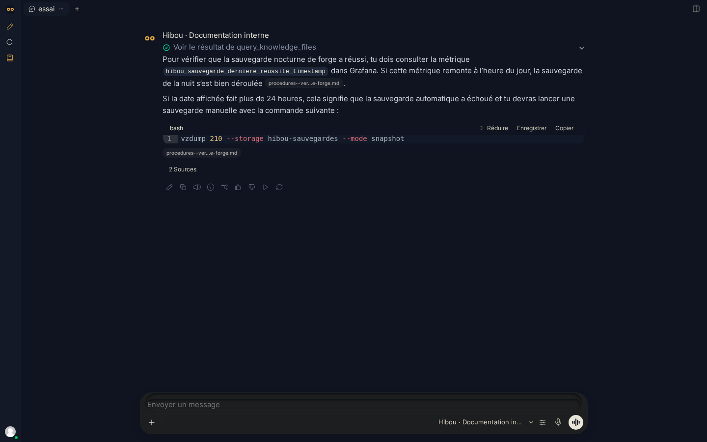
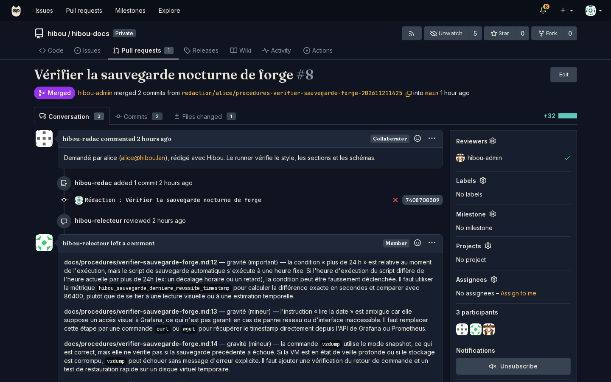
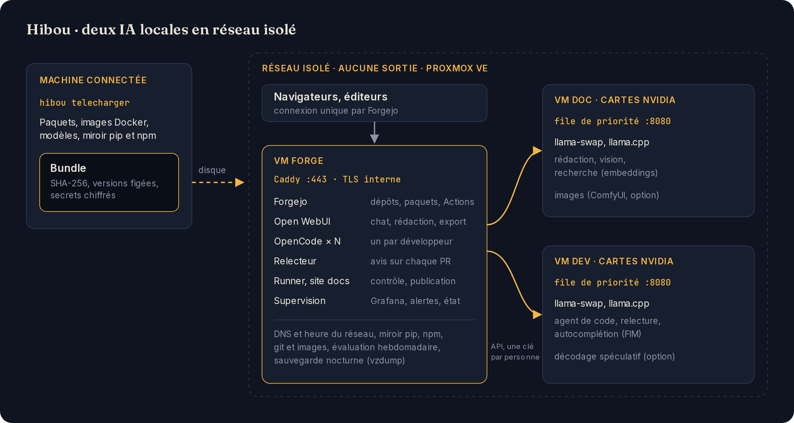

<div align="center">
  <picture>
    <source media="(prefers-color-scheme: dark)" srcset="charte/assets/Logos/hibou-symbole-sur-nuit.svg">
    
  </picture>
  <h1>HIBOU</h1>
  <p><strong>Deux IA locales, documentation et développement, installées d’un seul script dans un réseau sans Internet.</strong></p>
  <p>
    <a href="CHANGELOG.md"></a>
    <a href="LICENSE"></a>
    
    
    
    
  </p>
</div>

<p align="center">
  
  
</p>

## Ce que c’est

- **Une IA de documentation** (`chat.<domaine>`) : cinq rédacteurs (procédure, fiche technique, guide, architecture,
  décision), export Word, PDF, PowerPoint et Excel dans la conversation, publication dans Forgejo par pull request,
  réponses sourcées sur la documentation validée, compression des longues conversations (désactivable par chacun),
  et en option une base de sécurité : les guides de l’ANSSI et tes textes de référence (IGI 1300…), avec un modèle qui les cite.
- **Une IA de développement** (`code.<domaine>`) : une instance OpenCode par développeur, hors ligne (pip et npm par
  le miroir), qui crée le dépôt, travaille sur une branche et ouvre la pull request ; autocomplétion pour les éditeurs.
- **Tout autour** : Forgejo (dépôts, paquets, Actions), relecture automatique de chaque pull request, site de
  documentation, file de priorité par personne, connexion unique, supervision, évaluation hebdomadaire des modèles,
  sauvegarde nocturne.

> **Rien ne sort.** Les VM Hibou n’ont pas de passerelle vers Internet. Tout entre par un bundle préparé sur une
> machine connectée, vérifié par empreintes, aux versions figées. Les IA proposent, une personne fusionne.

<p align="center">
  <a href="docs/images/architecture.png"></a>
  <br><sub>Clique sur le schéma pour l’ouvrir en grand. Source vectorielle : <a href="docs/images/architecture.svg">architecture.svg</a>.</sub>
</p>

## Versions publiées

| Version | Date | Contenu | Notes |
| --- | --- | --- | --- |
| `v0.9.1` | 21/11/2026 | Charte appliquée au maximum (exports, chat, site docs), connexion Grafana réparée, thèmes générés publiés | [changelog](CHANGELOG.md) · [preuves](JOURNAL-CORRECTIONS.md) |
| `v0.9.0` | 21/11/2026 | Installation complète validée sur une machine réelle ; profil 4 Go, export de documents, compression du contexte, OpenCode par personne | [notes](docs/notes-de-version/v0.9.0.md) · [preuves](JOURNAL-CORRECTIONS.md) |
| `v0.1.0` | 16/11/2026 | Script, charte, architecture | [changelog](CHANGELOG.md) |

Suite prévue : validation sur serveurs multi-cartes (24 à 96 Go), génération d’images, mise aux couleurs complète du chat.

## Matériel

| Rôle | Où | Minimum |
| --- | --- | --- |
| `forge` | Un nœud Proxmox (ou un cluster) | 2 cœurs, 12 Go de RAM, 80 Go de disque |
| `doc` | Hôte avec une ou plusieurs cartes NVIDIA en passthrough | 4 Go de mémoire vidéo |
| `dev` | Idem, cartes distinctes de celles de doc | 4 Go de mémoire vidéo |

Le profil de modèles suit la mémoire vidéo du serveur (plusieurs cartes s’additionnent) :

| Mémoire vidéo | dev | doc |
| --- | --- | --- |
| ≥ 4 Go | Qwen3.5 4B, 32k | Qwen3.5 4B, vision, 8k |
| ≥ 12 Go | Qwen3.5 9B, 64k + complétion 1.5B | Qwen3.5 9B, 32k |
| ≥ 24 Go | Qwen3.8 27B Q4, 64k + complétion 3B | Gemma 4 26B Q4 (64k) ou Qwen3.8 27B Q4 (32k), vision |
| ≥ 48 Go | Qwen3-Coder-Next Q3 ou Qwen3.8 27B Q8 + complétion 7B | Gemma 4 26B Q8 ou Qwen3.8 27B Q8, 128k |
| ≥ 90 Go | Qwen3-Coder-Next Q6 (256k) ou Qwen3.8 27B Q8 | — |

## Installer

Sur la machine connectée (Ubuntu avec Docker), bundle sur un disque à part :

```shell
./hibou autotest                          # cohérence des réglages
./hibou telecharger /mnt/hibou/bundle     # questions, puis paquets, images, modèles, miroir
./hibou verifier /mnt/hibou/bundle        # empreintes SHA-256
```

Sur chaque hôte Proxmox, en root, disque branché :

```shell
./hibou installer forge                   # en premier
./hibou installer doc                     # hôte des cartes doc
./hibou installer dev                     # hôte des cartes dev
./hibou mettre-a-jour <rôle>              # plus tard : n’apporte que ce qui a changé
```

Pas à pas, réponses du menu et dépannage : [docs/installation.md](docs/installation.md).

## Organisation du dépôt

| Dossier | Contenu |
| --- | --- |
| `hibou` | Le script : préparation, installation, mise à jour, évaluation |
| `hibou-miroir.py` | Miroir pip, npm, git et images Docker publié dans Forgejo |
| `amorces/` | Dépôts amorcés (`hibou-docs`, `hibou-eval`), outils, filtre et modèles d’Open WebUI |
| `charte/` | Charte graphique : jetons, logos, icônes, polices, thèmes |
| `docs/` | Installation, architecture, fonctionnalités, notes de version, captures |

## Documentation

| | |
| --- | --- |
| **Découvrir** | [Fonctionnalités](docs/FONCTIONNALITES.md) · [Architecture](docs/architecture.md) · [Captures](docs/captures/0.9.0) |
| **Installer** | [Installation pas à pas](docs/installation.md) · [Aide-mémoire du bundle](docs/LISEZMOI-0.9.0.md) |
| **Versions** | [Notes 0.9.0](docs/notes-de-version/v0.9.0.md) · [Changelog](CHANGELOG.md) · [Journal des corrections](JOURNAL-CORRECTIONS.md) |
| **Charte** | [Charte graphique](charte/LISEZMOI.md) |
| **Contribuer** | [Contribuer](CONTRIBUTING.md) · [Sécurité](SECURITY.md) |

## Sécurité

- **Hors ligne** : aucune connexion sortante, bundle vérifié par SHA-256, versions figées dans `versions.lock`.
- **Secrets** : chiffrés dans le bundle (AES-256, PBKDF2), jamais écrits dans les journaux ni affichés par les agents.
- **Accès** : TLS par une autorité interne, connexion unique par Forgejo, ports des serveurs GPU ouverts à forge seulement.
- **Agents** : sans droits root, `main` protégée dans tous les dépôts, fusion humaine, commandes dangereuses refusées.
- **Pas encore fait** : authentification à deux facteurs imposée, rotation automatique des jetons.

## Développement

```shell
bash -n hibou                             # syntaxe
./hibou autotest                          # profils, images, file de priorité
```

Une correction se note dans [JOURNAL-CORRECTIONS.md](JOURNAL-CORRECTIONS.md) : symptôme, cause, diff, test qui la
prouve. Règles complètes : [CONTRIBUTING.md](CONTRIBUTING.md).

## Licence

[MIT](LICENSE), © 2026 Marty-McFIy.
