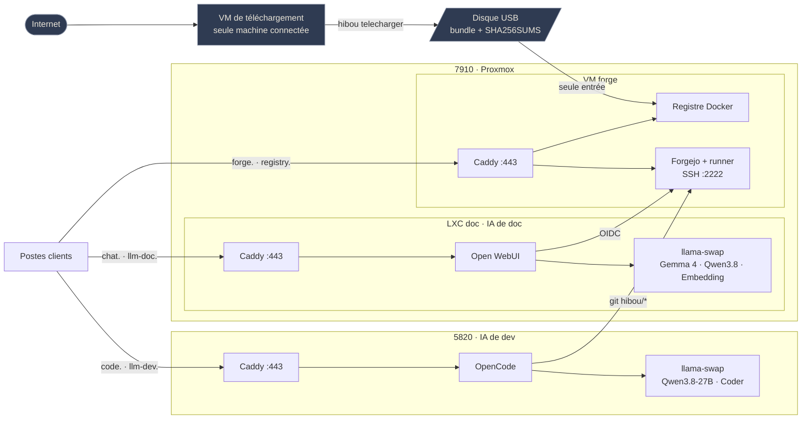

# Hibou — Architecture de l’infrastructure IA hors ligne

_Jérémy · 16 novembre 2026_

## Objectif et principes

Hibou fournit deux IA locales sans aucune connexion sortante : une IA de développement sur le Precision 5820 et une IA de documentation sur le Precision 7910, avec Forgejo comme dépôt de code commun. Un utilisateur par IA pour l’instant.

- **Local** : modèles GGUF servis par llama.cpp (`llama-server`, API compatible OpenAI), tout en conteneurs Docker.
- **Isolé** : aucune route vers Internet. Tout entre par un bundle préparé sur une VM de téléchargement, vérifié par SHA-256.
- **Discret** : interfaces Open WebUI, OpenCode et Forgejo habillées à la charte Hibou, polices et assets servis localement.
- **Reproductible** : chaque service est un `docker compose` versionné dans Forgejo, avec des tags d’images figés (jamais `latest`).

## Vue d’ensemble

Deux nœuds (5820 et 7910), deux guests sur le 7910 (`doc` en LXC, `forge` en VM) et une seule entrée : le bundle transporté par disque, déposé dans le registre de `forge`, d’où les deux nœuds tirent leurs images. Les adresses sont en `*.hibou.lan`.

Chaque IA tourne sur sa propre carte et reste joignable via Caddy en HTTPS ; Forgejo et le registre, dans la VM `forge`, servent les deux nœuds. La seule entrée est le bundle déposé par disque dans le registre.

## Nœud 5820 : IA de développement

Ubuntu 26.04.1 en natif, pilote NVIDIA + NVIDIA Container Toolkit, Docker Engine. La RTX 6000 Ada (48 Go) sert un seul modèle de code avec un long contexte.

| Conteneur | Rôle | Port interne |
| --- | --- | --- |
| `llama-dev` (image `llama.cpp:server-cuda`, tag figé) | Modèle de code, API OpenAI | 8080 |
| `opencode` | Agent de code, branché sur `llama-dev` et sur Forgejo (clone/push en SSH) | 4096 |
| `caddy` | Reverse proxy TLS | 443 |

Les modèles sont servis par **llama-swap** devant `llama-server` : un seul point d’API, le modèle demandé est chargé à la volée et déchargé après inactivité. Catalogue du 5820 (état de l’art de novembre 2026, à valider sur tes tâches) :

| Modèle | Quantification | Taille | Usage | Chargement |
| --- | --- | --- | --- | --- |
| Qwen3.8-27B + mmproj | Q8_0 | 29 Go + 0,9 Go | Modèle par défaut : agent de code, lecture de captures | À la demande |
| Qwen3-Coder-Next (80B, 3B actifs) | Q4 | ~38 Go | Alternative MoE plus rapide | À la demande, exclusif |
| Qwen2.5-Coder 7B | Q8_0 | ~8 Go | Autocomplétion FIM dans l’éditeur | Groupe permanent avec Qwen3.8 |

Paramètres de départ pour Qwen3.8-27B : `-ngl 99 -c 131072 -fa on --jinja`, décodage spéculatif MTP si la version de llama.cpp du bundle le prend en charge. Le `--jinja` est requis pour l’appel d’outils d’OpenCode.

OpenCode tourne en conteneur avec un volume `/workspace` et une clé SSH dédiée déclarée dans Forgejo. Le développeur s’y connecte par l’interface web d’OpenCode ou en TUI via SSH.

## Nœud 7910 Proxmox : IA de documentation

Proxmox VE 9.2-1 sur l’hôte, deux VM :

| Invité | Type | vCPU | RAM | Disque | Contenu |
| --- | --- | --- | --- | --- | --- |
| `doc` | Conteneur LXC Ubuntu 26.04.1 | 12 | 96 Go | 150 Go | llama-swap, Open WebUI, Caddy, les 4 GPU liés |
| `forge` | VM Ubuntu 26.04.1 | 2 | 4 Go | 60 Go | Forgejo, runner Forgejo Actions, registre Docker, site de documentation, Caddy |

Les 4 Quadro RTX 4000 sont liées au conteneur LXC `doc` plutôt que passées en PCI passthrough : pas de contrainte de groupes IOMMU, et les cartes restent visibles de l’hôte pour `nvidia-smi`.

1. Hôte Proxmox : pilote NVIDIA installé avec ses modules noyau, persistance activée (`nvidia-persistenced`).
2. Conteneur : options `nesting=1,keyctl=1` (Docker), et les périphériques `/dev/nvidia0` à `/dev/nvidia3`, `/dev/nvidiactl`, `/dev/nvidia-uvm`, `/dev/nvidia-uvm-tools` déclarés en entrées `dev0:` à `dev7:` de la configuration.
3. Dans le conteneur : la même version exacte du pilote, sans modules noyau (`--no-kernel-module`), puis NVIDIA Container Toolkit.
4. Commencer en conteneur non privilégié ; si le toolkit refuse de gérer les cgroups, passer `no-cgroups = true` dans sa configuration, ou en dernier recours un conteneur privilégié (risque acceptable sur un réseau isolé).

Contrainte forte : le pilote de l’hôte et celui du conteneur doivent toujours être mis à jour ensemble, depuis le même bundle.

llama-swap découpe chaque modèle sur les 4 cartes (`--split-mode layer --tensor-split 1,1,1,1`). Sur des cartes Turing, un modèle MoE est plusieurs fois plus rapide qu’un dense de taille comparable. Catalogue du conteneur `doc` :

| Modèle | Quantification | Taille | Usage | Chargement |
| --- | --- | --- | --- | --- |
| Gemma 4 26B-A4B + mmproj | UD-Q6_K_XL | ~24 Go | Modèle par défaut : rédaction, lecture d’images, schémas | À la demande |
| Qwen3.8-27B + mmproj | Q4_K_M | ~17 Go | Alternative pour l’OCR structuré et les captures techniques | À la demande, exclusif |
| Modèle d’embedding (Qwen3-Embedding 0.6B, à confirmer) | Q8_0 | <1 Go | Indexation RAG d’Open WebUI | Permanent, sur CPU |

Contexte de départ : 64k pour Gemma 4, 32k pour Qwen3.8 en Q4.

Open WebUI pointe sur le llama-swap local et peut aussi exposer celui du 5820. Il utilise le modèle d’embedding pour indexer les templates et la documentation existante (voir la section suivante). Les schémas sont produits en Mermaid, rendus dans le chat et dans Forgejo.

## Production documentaire : sujet + template

L’utilisateur donne un sujet et choisit un template ; Hibou rédige, propose le document en pull request dans Forgejo, et le runner le vérifie puis le publie.

1. **Templates** : un dépôt `hibou-templates` dans Forgejo, un fichier Markdown par type (procédure, fiche technique, guide utilisateur, architecture…), avec un en-tête YAML qui décrit les sections attendues, le public et le niveau de détail.
2. **Choix dans Open WebUI** : un modèle personnalisé par template (« Hibou · Procédure ») qui embarque le template dans son prompt système, ou une invite à variables `{{sujet}}`, `{{public}}`. Les templates et la documentation existante sont indexés en base de connaissances (RAG) pour garder le vocabulaire et le style maison.
3. **Rédaction** : Markdown conforme au template, schémas en blocs Mermaid, images commentées depuis les captures fournies.
4. **Publication** : un outil Open WebUI « Publier dans Forgejo » (fonction Python locale) crée une branche et une pull request via l’API Forgejo, avec un jeton dédié limité au dépôt `hibou-docs`.
5. **Vérification par le runner Forgejo Actions** : `markdownlint`, contrôle des sections obligatoires du template, rendu des schémas avec `mermaid-cli` (échec si un schéma est invalide), construction du site MkDocs.
6. **Relecture et fusion** par l’utilisateur ; la fusion publie le site statique sur `docs.hibou.lan`, servi par Caddy sur la VM `forge`.

Le runner tourne en conteneur avec des images préchargées depuis le registre local : aucune action ne doit référencer `github.com` ou `code.forgejo.org`, les actions utilisées sont recopiées dans Forgejo.

## Forgejo : emplacement, sauvegarde, migration

Recommandation : Forgejo en conteneur Docker, dans la petite VM `forge` du Proxmox. Les deux couches se complètent : la VM se sauvegarde et se restaure d’un bloc, le conteneur se déplace sur n’importe quel hôte Docker.

Pourquoi pas sur le 5820 : Forgejo serait arrêté à chaque redémarrage pour un pilote ou un modèle, et son disque de 240 Go est déjà pris par les modèles. Pourquoi pas dans le conteneur `doc` : elle porte les GPU, on la redémarre plus souvent.

Organisation :

- Tout l’état dans un seul dossier `/srv/forgejo/` : `docker-compose.yml`, `data/` (dépôts, LFS, avatars), `db/` (SQLite pour 2 utilisateurs, PostgreSQL inutile à ce stade), `custom/` (thème Hibou).
- Sauvegarde applicative quotidienne : `forgejo dump` en tâche cron, archive horodatée copiée hors de l’hôte.
- Sauvegarde système : `vzdump` de la VM `forge` vers un stockage distinct du NVMe (voir Stockage).
- Déplacement : arrêter le conteneur, copier `/srv/forgejo/` sur le nouvel hôte, `docker compose up -d`, mettre à jour l’entrée DNS `forge.hibou.lan`. Les clones gardent la même URL.

La VM `forge` héberge aussi un registre Docker local (`registry:2`) : les images du bundle y sont poussées une fois, puis tirées par les deux nœuds.

## Réseau, ports, DNS, TLS

Un réseau local isolé sans passerelle par défaut, adressage statique. Les noms en `hibou.lan` sont donnés à titre d’exemple.

| Nom | Hôte | Service | Port exposé |
| --- | --- | --- | --- |
| `pve.hibou.lan` | 7910 | Console Proxmox | 8006 |
| `forge.hibou.lan` | VM `forge` | Forgejo web / SSH Git | 443 / 2222 |
| `registry.hibou.lan` | VM `forge` | Registre Docker | 443 |
| `chat.hibou.lan` | VM `doc` | Open WebUI | 443 |
| `llm-doc.hibou.lan` | VM `doc` | API `llama-doc` | 443 |
| `code.hibou.lan` | 5820 | OpenCode | 443 |
| `llm-dev.hibou.lan` | 5820 | API `llama-dev` | 443 |

DNS : un `dnsmasq` sur la VM `forge`, ou des entrées `/etc/hosts` tant qu’il n’y a que trois machines. TLS : une autorité de certification interne (Caddy `tls internal` ou `step-ca`), dont le certificat racine est installé sur les postes clients. Les ports 8080 de `llama-server` ne sont jamais exposés directement : Caddy ajoute une clé d’API en en-tête.

Heure : un serveur NTP local (chrony sur l’hôte Proxmox) pour que les certificats et les journaux restent cohérents sans Internet.

## Stockage et points de vigilance

Le stockage est la contrainte principale des deux machines : à prévoir avant l’installation.

| Machine | Disque | Occupation estimée | Verdict |
| --- | --- | --- | --- |
| 5820 | 2 × 240 Go en miroir (240 Go utiles) | OS 25 Go, Docker 30 Go, modèle 32 Go, bundle de mise à jour 60 Go | Tient pour un modèle, aucune marge pour en garder deux ou pour un bundle complet |
| 7910 | NVMe 250 Go | Proxmox 20 Go, VM `doc` 120 Go, VM `forge` 40 Go, sauvegardes `vzdump` | Plein dès la première sauvegarde |

Recommandations :

- Ajouter un disque de 1 à 2 To sur le 7910 (SATA ou second NVMe) pour les modèles, le dépôt de bundles et les sauvegardes `vzdump`. Idéalement, une copie des sauvegardes sur un disque amovible.
- Sur le 5820, un disque de données de 1 To pour `/srv/models` et les bundles, le miroir 240 Go restant dédié au système.
- Les Quadro RTX 4000 (Turing) sont prises en charge par llama.cpp en CUDA avec flash attention, mais moins vite que l’Ada : viser des modèles quantifiés en Q4 et un contexte modéré.
- Les Xeon E5-2637 v4 n’ont que 4 cœurs chacun (8 au total) : laisser 2 cœurs à l’hôte Proxmox.
- Vérifier que les versions du pilote NVIDIA et de CUDA choisies prennent en charge à la fois Ada (5820) et Turing (7910), pour n’avoir qu’une seule branche dans le bundle.

## Chaîne de téléchargement et bundle air gap

La VM de téléchargement (Ubuntu 26.04.1, connectée) produit un bundle daté, vérifié puis transporté sur disque. Elle doit avoir la même version d’Ubuntu que la cible pour que les dépendances apt correspondent.

Contenu d’un bundle `hibou-bundle-AAAAMMJJ/` :

| Dossier | Contenu | Outil de production |
| --- | --- | --- |
| `apt/` | Docker Engine, NVIDIA Container Toolkit, pilote NVIDIA, outils (chrony, dnsmasq) avec toutes leurs dépendances, indexés en dépôt local | `apt-get download` + résolution des dépendances, `dpkg-scanpackages` |
| `images/` | `llama.cpp:server-cuda`, `open-webui`, `opencode`, `forgejo`, `caddy`, `registry` (tags figés), plus llama-swap, forgejo-runner, l’image de build MkDocs et mermaid-cli | `docker pull` puis `docker save \| zstd` |
| `models/` | Fichiers GGUF et `mmproj` | `huggingface-cli download` |
| `hibou/` | Thèmes, polices, logos, fichiers compose | Dépôt de configuration |
| `SHA256SUMS` + `MANIFEST.md` | Empreintes et liste des versions | `sha256sum` |

À l’arrivée : vérifier `SHA256SUMS`, monter `apt/` comme source locale (`deb [trusted=yes] file:/…`), charger les images dans le registre de `forge` (`docker load` puis `docker push registry.hibou.lan/…`), copier les modèles dans `/srv/models` de chaque nœud. Les mises à jour suivantes sont des bundles différentiels : uniquement les paquets et images qui changent.

Les images Docker sont téléchargées pour `linux/amd64` uniquement. Open WebUI doit être configuré en mode hors ligne (`OFFLINE_MODE=true`, `HF_HUB_OFFLINE=1`) et son modèle d’embedding, s’il sert au RAG, fait partie du bundle.

## Personnalisation Hibou

Les trois interfaces reprennent les jetons de la charte (thème Nuit par défaut, Brume en clair), les polices Fraunces, Inter et JetBrains Mono servies en local, et le symbole Hibou. Aucune police ni ressource chargée depuis le réseau.

| Interface | Mécanisme | Éléments Hibou |
| --- | --- | --- |
| Forgejo | Dossier `custom/` : CSS de thème (`theme-hibou-nuit.css`, `theme-hibou-brume.css` déclarés dans `[ui] THEMES`), gabarits `custom/templates/`, logo et favicon dans `custom/public/assets/img/` | Jetons, logo, page d’accueil « L’IA qui veille chez vous. » |
| Open WebUI | `WEBUI_NAME=Hibou`, CSS et logos montés en volume sur les fichiers statiques, polices locales | Jetons, logo, favicon, attente par les deux yeux qui clignent |
| OpenCode | Thème JSON dans `~/.config/opencode/themes/hibou.json`, sélectionné dans la configuration | Couleurs du terminal en `nuit`, accent `ambre` |

Open WebUI conditionne le retrait de sa propre marque à son contrat de licence : à vérifier sur la version retenue, l’usage à un utilisateur restant dans le cadre autorisé à ce jour.

Les surcharges de CSS dépendent de la structure HTML de chaque version : à revalider à chaque mise à jour d’image.

## Identité et accès

Forgejo est la source unique des comptes : il sert de fournisseur OpenID Connect aux autres services. Un compte désactivé dans Forgejo perd l’accès partout.

| Service | Méthode | Réglage clé |
| --- | --- | --- |
| Open WebUI | OIDC natif | `OPENID_PROVIDER_URL=https://forge.hibou.lan/.well-known/openid-configuration`, `ENABLE_OAUTH_SIGNUP=true`, connexion par mot de passe désactivée |
| OpenCode (web) | `oauth2-proxy` devant, branché sur Forgejo | Accès limité au groupe `dev` |
| Grafana | OAuth générique | Rôles déduits des groupes Forgejo |
| Proxmox | Domaine OpenID | Compte `root@pam` gardé en secours |
| API llama-swap | Clé par client, vérifiée par Caddy | Une clé pour OpenCode, une pour Open WebUI, une pour le jeu d’évaluation |

Deux groupes Forgejo suffisent au départ : `dev` et `doc`. Un compte administrateur local de secours existe sur chaque service, mot de passe sous enveloppe scellée. L’authentification à deux facteurs TOTP est activée dans Forgejo, elle fonctionne hors ligne.

## Droits de l’agent de code

OpenCode travaille avec un compte Forgejo dédié `hibou-dev` et ne peut rien fusionner seul : tout passe par une pull request que tu valides.

- **Forgejo** : `main` protégée (pull request obligatoire, approbation de ton compte, push direct interdit). `hibou-dev` n’écrit que sur des branches `hibou/*`.
- **Conteneur** : utilisateur non root, seul le volume `/workspace` monté, pas de socket Docker, réseau Docker interne qui ne voit que llama-swap et Forgejo.
- **Permissions OpenCode** (fichier `opencode.json`) :

| Action | Règle |
| --- | --- |
| Lecture de fichiers, recherche | Autorisée |
| Modification de fichiers dans `/workspace` | Autorisée |
| `git status`, `git diff`, tests, linters | Autorisés |
| `git commit`, `git push` sur `hibou/*` | Sur demande |
| `rm`, `chmod`, gestionnaires de paquets, `curl` | Sur demande |
| Tout le reste en shell | Sur demande |
| `git push` sur `main`, `sudo` | Refusés |

## Chaîne de mise à jour

Un bundle par mois au plus, un par trimestre par défaut, et toujours un retour arrière possible en moins d’une heure.

1. **Préparer** sur la VM de téléchargement : nouvelles versions dans `MANIFEST.md`, téléchargement, `SHA256SUMS`.
2. **Contrôler** : scan des images avec Trivy en mode hors ligne (sa base de vulnérabilités fait partie du bundle), lecture des notes de version de llama.cpp, Open WebUI, Forgejo et OpenCode.
3. **Tester** sur la VM de téléchargement : démarrage des conteneurs, migration de base Forgejo sur une copie.
4. **Transférer et vérifier** les empreintes à l’arrivée.
5. **Sauvegarder** : instantané Proxmox de `forge` et `doc`, `forgejo dump`.
6. **Déployer** nœud par nœud : nouvelles images poussées dans le registre local avec leur tag de version, les anciens tags conservés.
7. **Valider** avec le jeu d’évaluation (section suivante) avant d’adopter un nouveau modèle.

Retour arrière : remettre l’ancien tag dans le fichier compose, ou restaurer l’instantané. On garde la version N-1 de chaque image et de chaque modèle. Les pilotes NVIDIA ne changent qu’au besoin, jamais en même temps qu’une autre brique.

## Jeu d’évaluation maison

Un dépôt `hibou-eval` de 20 tâches réelles décide quel modèle sert quoi, et vérifie qu’une mise à jour ne dégrade rien.

| Famille | Nombre | Exemple | Notation |
| --- | --- | --- | --- |
| Code | 8 | Corriger un bug avec test fourni, écrire un module, refactoriser | Automatique : les tests passent ou non |
| Documentation | 8 | Produire un document depuis un sujet et un template | Grille notée par toi de 1 à 5 : conformité au template, exactitude, qualité du français, schémas valides |
| Vision | 4 | Décrire une capture d’écran, extraire un tableau d’une image, transcrire un schéma | Comparaison à une réponse de référence |

Un script interroge chaque modèle du catalogue llama-swap par l’API, mesure le temps et les tokens par seconde, et enregistre les résultats dans un CSV versionné. Le runner Forgejo peut le lancer à la demande. Règle d’adoption proposée : un nouveau modèle remplace l’actuel s’il fait au moins aussi bien sur le code et la documentation, sans perte de vitesse de plus de 20 %.

## Supervision

Tout sur la VM `forge`, consulté dans Grafana, alertes sur un serveur `ntfy` local (notifications navigateur et téléphone sur le réseau interne).

| Élément surveillé | Outil | Alerte |
| --- | --- | --- |
| Disponibilité des services web et API | Uptime Kuma | Service injoignable plus de 2 minutes |
| CPU, RAM, disques des trois machines | Prometheus + `node_exporter` | Disque plein à plus de 85 % |
| GPU : température, mémoire, charge | `nvidia_gpu_exporter` (basé sur `nvidia-smi`, compatible Ada et Turing) | Température supérieure à 85 °C |
| État des disques | `smartctl_exporter` | Erreur SMART |
| Sauvegardes | Statut des tâches `forgejo dump` et `vzdump` | Échec ou absence depuis plus de 26 heures |

Rétention des métriques : 30 jours, suffisant pour comparer avant et après une mise à jour.

## Plan de déploiement et décisions ouvertes

1. Ajouter les disques de données sur les deux machines.
2. Préparer la VM de téléchargement et produire le premier bundle.
3. 7910 : installer Proxmox 9.2-1, activer l’IOMMU, installer le pilote NVIDIA sur l’hôte, créer la VM `forge`.
4. VM `forge` : Docker, registre local, DNS, Forgejo thémé, dépôt `hibou-infra` avec tous les fichiers compose.
5. 5820 : Ubuntu 26.04.1, pilote NVIDIA, Docker, `llama-dev`, OpenCode, Caddy.
6. 7910 : VM `doc` en LXC avec les 4 GPU liés, `llama-doc`, Open WebUI, Caddy.
7. Recette : génération de code avec push vers Forgejo, rédaction Markdown, lecture d’image, schéma Mermaid.
8. Sauvegardes `forgejo dump` et `vzdump` planifiées, puis un test de restauration.

Décisions ouvertes :

1. Modèles retenus pour chaque IA (à tester sur un jeu de tâches réelles).
2. Disques supplémentaires : capacité et emplacement.
3. OpenCode utilisé depuis un poste client ou dans le navigateur.
4. Plan d’adressage et nom de domaine interne.
5. Contenu du dépôt GitHub Hibou à intégrer (dépôt privé, non lu).
