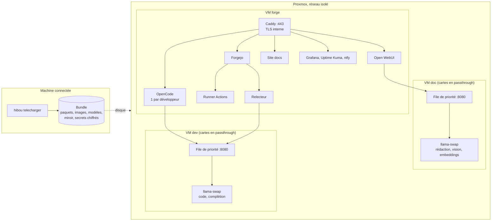

# Architecture de Hibou 0.9

## Principes

- **Hors ligne.** Aucune VM Hibou ne sort sur Internet. Tout ce qui sert entre par un bundle préparé sur une machine
  connectée, vérifié par empreintes, aux versions figées (`versions.lock`).
- **Un script.** `hibou` prépare, installe, met à jour, configure, évalue. Pas d’étape manuelle dans les VM.
- **Indépendant du matériel.** Le profil de modèles suit la mémoire vidéo de chaque serveur, de 4 Go à plus de 90 Go,
  une ou plusieurs cartes. Les réglages propres à un site passent par le menu ou des variables, jamais par le script.
- **Humain dans la boucle.** Les IA proposent (pull request), une personne relit et fusionne.

## Vue d’ensemble

## Rôles

| Rôle | VM | Contenu |
| --- | --- | --- |
| `forge` | Sur un nœud Proxmox ; 2 cœurs, 12 Go, 80 Go au minimum | Forgejo, Open WebUI, OpenCode, Caddy, oauth2-proxy, registre, runner, relecteur, Prometheus, Alertmanager, Grafana, Uptime Kuma, ntfy |
| `doc` | Sur l’hôte de ses cartes ; toute la mémoire moins 16 Go (ou `HIBOU_RAM_GPU`) | Pilote NVIDIA figé, llama-swap (llama.cpp CUDA), file de priorité, exporteurs ; ComfyUI si une carte d’images est prévue |
| `dev` | Idem | Pilote, llama-swap, file de priorité, exporteurs |
| `noeud` | Aucune VM | Exporteurs de supervision sur les autres hôtes |

Les VM sont créées par cloud-init depuis l’image Ubuntu du bundle, processeur `host`, agent QEMU, disque agrandi à
toute la taille demandée. Les cartes passent entières à la VM (`vfio-pci`, sans redémarrage de l’hôte).

## Serveurs de modèles

- **llama-swap** charge les modèles du profil à la demande (`ttl: 0`, groupes exclusifs si la mémoire est juste).
  Chaque modèle : contexte réel déclaré, `-np 1` (tout le contexte pour la requête en cours), cache KV en `q8_0`,
  `-fa on`. Plusieurs cartes : `--split-mode layer`.
- **File de priorité** (service `priorite`, port 8080) : vérifie la clé, une génération à la fois par modèle ; quand une
  place se libère, l’utilisateur le mieux classé passe, à rang égal le premier arrivé ; rien n’est interrompu.
  Métriques : requêtes, attente, tokens, contexte utilisé et maximal, par modèle et par utilisateur.
- **Embeddings** sur le processeur (doc), **complétion FIM** (dev) sur la carte ou le processeur selon le profil,
  **vision** par projecteur multimodal, **ébauche** pour le décodage spéculatif (option).
- **Pare-feu** : les ports 8080, 8188, 9100 et 9835 ne répondent qu’à forge.

## forge

| Service | Rôle | Accès |
| --- | --- | --- |
| Caddy | Seul point d’entrée, TLS par l’autorité interne, pages d’erreur à la charte | 443 |
| Forgejo | Dépôts, équipes, paquets (pip, npm, conteneurs), Actions, fournisseur OIDC | `forge.`, SSH 2222 |
| Open WebUI | Chat, rédacteurs Hibou, outils, bases de connaissances, filtre de compression | `chat.` |
| OpenCode | Un conteneur par personne de l’équipe dev (`opencode-<utilisateur>`) | `code.`, routé par compte |
| oauth2-proxy | Connexion par Forgejo devant OpenCode, le site docs, l’état et les alertes | — |
| Registre | Images Docker locales | `registry.` |
| Runner | Contrôle et publication de la documentation (image `docs-builder`) | — |
| Relecteur | Avis consultatif sur chaque pull request, par le LLM de dev | webhook d’organisation |
| Supervision | Prometheus, Alertmanager, Grafana, Uptime Kuma, ntfy | `supervision.`, `etat.`, `alertes.` |

forge sert aussi le DNS du domaine (dnsmasq) et l’heure (chrony) au réseau isolé.

## Identité et accès

| Service | Connexion | Droits |
| --- | --- | --- |
| Forgejo | Comptes créés par le script, mot de passe à changer à la première connexion | Équipes `dev`, `doc`, `relecture`, `Owners` |
| Open WebUI | OIDC Forgejo, pas de formulaire local | Modèles, outils et bases Hibou ouverts à tous les comptes ; conversations et fichiers personnels |
| OpenCode | oauth2-proxy, groupes `dev` et `owners` | Chaque personne arrive sur sa propre instance ; sans instance : refus clair |
| Grafana | OAuth Forgejo | Administrateur pour `owners`, lecture pour les autres |
| Proxmox | Domaine OpenID `forgejo` | L’administrateur Hibou est Administrator |
| API des modèles | Clé par utilisateur | Rang de priorité de l’utilisateur |

## Chaîne documentaire

1. Une personne demande un document à un rédacteur Hibou (procédure, fiche technique, guide, architecture, décision) ;
   le modèle suit le gabarit du type, s’appuie sur la base « Hibou · Templates ».
2. Elle valide le brouillon ; l’outil `publier_forgejo` crée `redaction/<personne>/<chemin>-<date>`, commite au nom de
   la personne et ouvre la pull request dans `hibou-docs`.
3. Le runner contrôle le style Markdown, les sections du gabarit et les schémas Mermaid ; le relecteur donne son avis.
4. Une autre personne approuve et fusionne. Le site `docs.` est reconstruit et la base « Hibou · Documentation »
   resynchronisée : le modèle « Documentation interne » répond alors avec cette page comme source.
5. À tout moment, l’outil `exporter_document` produit un `.docx`, `.pdf`, `.pptx` ou `.xlsx` téléchargeable.

Longues conversations : le filtre `compression_contexte` résume les anciens échanges au-delà de la moitié du contexte
du modèle (l’autre moitié reste pour les extraits de la base) et garde les derniers messages tels quels.

## Chaîne de code

1. La personne parle à son instance OpenCode ; l’agent lit `AGENTS.md` (hors ligne, miroir, règles Forgejo).
2. Nouveau projet : `forgejo-nouveau-depot` crée le dépôt, protège `main`, clone, pose un `.gitignore`.
3. L’agent travaille sur `agent/<sujet>`, teste (pytest fourni), puis `forgejo-pr` pousse et ouvre la pull request
   « Demandé par @<personne> ». Commits au nom de la personne, committer `hibou-dev`.
4. Le relecteur commente ; une personne fusionne.

Garde-fous : `main` protégée dans tous les dépôts (push direct refusé, une approbation, règle appliquée aux
administrateurs), pas de création de dépôt par push, conteneur non root sans socket Docker, refus d’office de
`sudo`, `apt`, `--index-url`, `rm -rf .git`, de l’affichage des secrets ; le reste des commandes est soumis à
l’accord de la personne dans l’interface.

## Bundle, versions et mises à jour

| Dossier | Contenu |
| --- | --- |
| `apt/` | Paquets Ubuntu (VM) et Proxmox (hôtes), pilote NVIDIA figé, NVIDIA Container Toolkit |
| `images/` | Images Docker en `.tar.zst`, tirées par empreinte, plus les images construites localement |
| `models/<rôle>/` | GGUF du profil choisi, révision Hugging Face figée |
| `mirror/` | pip, npm, git, images à publier dans Forgejo |
| `owui-py/` | Modules Python d’export PDF pour Open WebUI |
| `extra/` | Image cloud Ubuntu, exportateur SMART |
| `amorces/`, `charte/` | Dépôts amorcés, outils Open WebUI, modèles Hibou, thèmes |

`mettre-a-jour` ne recopie que les fichiers changés, ne recharge que les images changées, rejoue configuration,
consignes et outils, puis vérifie qu’aucun service ne redémarre en boucle. La VM ne redémarre que si le noyau ou le
pilote changent.

## Supervision, évaluation, sauvegardes

- Grafana : « Vue d’ensemble », « LLM en direct » (file d’attente, contexte, tokens/s), « Évaluation ».
- `hibou-eval` chaque dimanche à 4 h : tâches de code, de rédaction et de vision ; une erreur d’API compte 0.
- Alertes : Alertmanager vers ntfy ; état des services dans Uptime Kuma.
- Sauvegarde de forge chaque nuit à 3 h (vzdump, 7 jours et 4 semaines) et export Forgejo à 2 h. doc et dev se
  reconstruisent depuis le bundle.

## Charte

Thèmes Forgejo (`hibou-nuit`, `hibou-brume`, `hibou-auto`), Open WebUI (CSS, logos, écran de démarrage), OpenCode,
Grafana, site docs, pages d’erreur de Caddy, couleurs du terminal : toutes issues des jetons de `charte/`.
